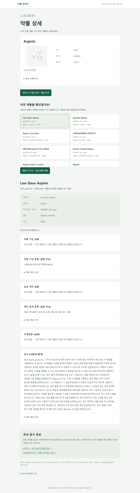

# PubChem 약물 탐색기

- **앱:** https://seeum0121-debug.github.io/pubchem-drug-explorer/
- **저장소:** https://github.com/seeum0121-debug/pubchem-drug-explorer

빌드 없는 정적 HTML/CSS/JavaScript ES modules 앱입니다. PubChem 화합물과 미국 openFDA 제품·라벨을 구분하여 표시합니다. 의료 조언·복약 지시·국내 의약품 데이터 서비스가 아닙니다.

## 구현된 앱

한글·영문 성분 검색 → 후보 확인 → 구조·분자식·분자량 확인 → 실제 제품 선택 → 한국어 약물 정보 순서로 사용합니다. 아스피린·아세트아미노펜·이부프로펜을 실제 Chrome과 공개 사이트에서 조회했습니다.

- 제품을 누르면 번역 버튼 없이 한국어 본문이 자동으로 표시됩니다. 최초 모델 다운로드·번역 진행·실패 상태가 구분됩니다.
- 한국어를 먼저 읽고, 필요한 항목의 **영문 원문 보기**를 펼칠 수 있습니다.
- 제품 목록은 이름·성분/함량·제형/경로에 집중합니다. UUID·NDC/SPL·CID–UNII 원시 근거와 연결 보류 사유는 마지막 **출처 및 데이터 근거**에 접혀 있습니다. 식별 검증은 그대로 유지합니다.
- 모델 초기화 promise를 언어쌍별로 재사용하고 번역을 순차 실행합니다. 제품을 바꾸면 이전 번역이 새 제품을 덮지 않습니다.

## 한국어 원자료 재조사

2026-11-17 공식 페이지를 제한적으로 재확인했습니다. **한국어로 번역된 미국 자료와 한국 원자료는 다릅니다.**

| 후보 | 확인된 범위와 접근 조건 | 현재 적용 |
| --- | --- | --- |
| [식약처 e약은요](https://nedrug.mfds.go.kr/searchEasyDrug) | 비로그인 공개 검색에 4,730건 및 엑셀다운로드 표시. 일반소비자를 위한 일반의약품 개요이며 모든 허가사항·모든 의약품을 담지 않음 | 앱의 ‘국내 공식 정보’에 외부 참고 링크 |
| [공공데이터포털 공식 e약은요 API](https://www.data.go.kr/data/15075057/openapi.do) | 한국어 효능·사용법·주의·상호작용·부작용·보관법, 무료이나 **ServiceKey 필수** | 새 가입/API 키 없음 조건 때문에 자동 통합하지 않음 |
| [식약처 품목 목록 자료실](https://nedrug.mfds.go.kr/bbs/42/10) | 품목 목록 XLSX 후보. 상세 임상 본문 포함 여부·재사용 조건·브라우저 직접 취득 가능성 미확인 | 상세 데이터로 사용하지 않음 |

이번 조사에서 **키 없이 재사용·자동 취득·정확한 성분/제품 대응까지 검증된 한국어 데이터는 확보하지 못했습니다.** 공개 웹 열람 가능성을 API의 ‘이용허락범위 제한 없음’과 동일시하지 않았습니다. 국내 허가정보는 [의약품안전나라 검색](https://nedrug.mfds.go.kr/searchDrug)에서 별도로 확인해야 합니다. 특정 국내 제품을 현재 선택 성분과 추정 연결하지 않았고, 기존 작동 미국 자료도 삭제하지 않았습니다.

## 실행

Node.js 24 이상에서 `npm ci`, `npm run serve` 실행 후 http://127.0.0.1:4173 에 접속합니다. 배포에는 Node.js나 패키지 설치가 필요하지 않습니다. `file://` 대신 로컬 HTTP 또는 HTTPS를 사용하세요.

## 사용

1. 한글 또는 영문 성분명을 입력합니다. PC Chrome의 기본 Translator API가 한글을 영문 후보로 번역합니다. 최초 모델 다운로드가 필요하며, 후보를 수정한 후 명시적으로 검색해야 합니다.
2. PubChem CID·성분명·구조를 확인하고 상세 페이지로 이동합니다.
3. 상세 페이지에서 다시 성분을 확인하면 출처 있는 UNII로 미국 라벨을 20개씩 조회합니다. 추가 조회는 사용자 버튼으로만 실행됩니다.
4. 정확한 NDC/SPL 버전/성분 근거가 연결된 제품을 선택합니다. 전체 성분·함량·제형·경로는 NDC 레코드에서, 약리·이상반응·경고는 해당 라벨에서 가져옵니다.
5. 제품 클릭에서 모델 준비와 한국어 번역이 자동 시작됩니다. 기전 분류는 기전 설명과 다르며, 경고는 이상반응을 대신하지 않습니다. 번역 실패 시 접힌 영문 원문을 펼쳐 확인하세요.

## 안전한 데이터 해석

- 이름·배열 순서·사용자 확인만으로 제품을 연결하지 않습니다. UNII, product_ndc, spl_id=label.id, spl_set_id=label.set_id를 검증합니다.
- 복합제의 성분–UNII 직접 대응이 없거나 염·버전·중복 키가 충돌하면 보류합니다. 이는 해당 자료의 연결 한계이며 약물 자체의 부재를 뜻하지 않습니다.
- 제형·경로·ADR 누락은 자료 없음으로 표시합니다. 다른 제품 라벨이나 경고를 끌어와 채우지 않습니다.
- 각 필드의 원본 경로·제공자·조회 시각을 출처 상세에서 확인할 수 있습니다. 라벨 effective_time은 조회 시각과 다른 원자료 날짜입니다.
- 번역 미지원·다운로드 실패 시 영어 검색과 영문 원문은 계속 사용할 수 있습니다. 번역을 정확한 의학 해석으로 간주하지 마세요.
- 모든 API 요청은 직렬, 기본 1초 간격, 20초 제한입니다. 429/일시적 5xx만 최대 두 번 재시도하며 장기 Retry-After는 중단 안내합니다. 세션 캐시와 취소·세대 검사를 적용합니다.
- API 키·백엔드·회원가입·유료 서비스·고정 한글 약물 사전이 없습니다.

## 검증

- `npm test`: fixture 기반 식별/요청 테스트.
- `node tests/browser.js`: Chrome 브라우저 모의 API/모의 번역 adversarial 테스트.
- `node tests/auto-browser.js`: 자동 번역 시작·user activation·모델 공유·제품 전환·다운로드 실패/재시도 검증.
- `node tests/image-browser.js`: JSON/PNG 공통 큐, 이미지 취소·시간 초과·URL 정리, 다음 페이지 실패 후 재시도 테스트.
- `node tools/pages-probe.js`: 공개 Pages에서 세 성분의 실제 구조·번역·제품 선택 검증.
- `/tests/index.html`: 브라우저 fixture 테스트 화면.
- `node tools/probe.js`: 실제 Chrome CORS/API/Translator 가용성 확인.
- `node tools/live-app.js`: 실제 API 기반 검색·제품 연결 확인.
- `node tools/translation-probe.js`: 실제 Chrome ko→en 후보·검색과 en→ko 라벨 번역.

Chrome은 설치되어 있어야 합니다. 자동화는 격리 프로필만 사용하며 기존 사용자 프로필을 변경하지 않습니다. 번역 모델 자동화는 Playwright 기본 component-update/background-networking 비활성화 인자를 제외해야 합니다. 테스트 서버는 127.0.0.1에만 바인딩합니다.

## GitHub Pages

저장소 main 브랜치의 루트를 Pages 소스로 지정합니다. `index.html`, `detail.html`, `assets/`, `js/`가 정적 배포물이며 상대 경로로 저장소 하위 URL에서도 동작합니다. 비밀값이나 사용자 프로필을 업로드하지 마세요.

실행 증거와 한계: [docs/verification.md](docs/verification.md).
