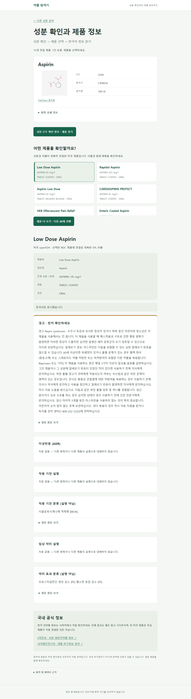
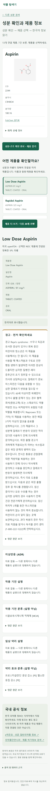

# PubChem 약물 탐색기

약의 **성분을 검색하고, 화학 구조와 제품별 약물 정보를 살펴보는 학습용 웹앱**입니다. 과제에서는 아스피린을 검색해 성분 확인부터 제품 정보 읽기까지 따라 해 볼 수 있습니다.

- **앱 바로가기:** https://seeum0121-debug.github.io/pubchem-drug-explorer/
- **GitHub 저장소:** https://github.com/seeum0121-debug/pubchem-drug-explorer

설치 없이 위 앱 링크를 열면 됩니다. **PC Chrome에서 사용하세요.** 한국어 번역은 처음 사용할 때 번역 모델을 내려받느라 시간이 걸릴 수 있으며, 브라우저 환경에 따라 지원되지 않을 수 있습니다.

## 사용 방법 — 아스피린 찾아보기

1. 앱을 열고 **성분명** 칸에 `aspirin`을 입력한 뒤 **후보 검색**을 누릅니다.
   - `아스피린`으로도 시도할 수 있습니다. 번역된 영문 후보가 맞는지 확인·수정하고 **이 성분으로 검색**을 누르세요.
   - 한글 번역이 실패하면 `aspirin`처럼 **영문 성분명으로 검색**하세요. 모든 한글 성분명의 검색을 보장하지는 않습니다.
2. 검색 결과의 성분명과 구조 그림을 확인하고 **성분·구조 확인 완료 → 상세 보기**를 누릅니다. CID는 PubChem에서 성분을 구별하는 번호입니다.
3. 상세 화면에서 성분을 다시 확인하고 **성분·구조 확인 완료 · 제품 찾기**를 누릅니다.
4. 미국 제품 목록에서 이름, 성분과 함량, 약의 형태를 보고 **제품 하나를 선택**합니다. 추가 결과가 있으면 **제품 더 보기 · 다음 20개 라벨**을 누를 수 있습니다.
5. 선택한 제품의 **경고와 이상반응부터 읽습니다.** 설명은 자동으로 한국어 번역을 시작하며, **영문 원문 보기**에서 원문도 확인할 수 있습니다. 번역이 실패하면 영문 원문이 펼쳐집니다.

다른 예시로 `acetaminophen`(아세트아미노펜), `ibuprofen`(이부프로펜)을 검색할 수 있습니다. 제품 연결 근거가 부족하면 목록에 나오지 않을 수 있고, 원자료에 없는 내용은 **자료 없음**으로 표시합니다.

## 어떤 정보를 볼 수 있나요?

| 기능·용어 | 쉽게 설명하면 |
| --- | --- |
| 성분 검색 | PubChem의 성분 정보와 구조 그림을 찾아봅니다. |
| 화학적 성질 | **분자식**은 어떤 원자가 몇 개 들어 있는지, **분자량**은 분자의 상대적인 무게를 나타냅니다. 구조 그림은 원자들이 어떻게 연결되어 있는지 보여줍니다. |
| 화학 상세 정보 | **XLogP**는 물과 기름 같은 환경 중 어디에 더 잘 녹는지 가늠하는 계산값입니다. IUPAC명은 정해진 규칙으로 지은 화학 이름, SMILES는 구조를 문자로 적은 표현입니다. |
| 제품 정보 | 제품명, 전체 성분과 함량, 제형(정제 등 약의 형태), 경로(먹는 약 등 투여 방식)를 확인합니다. |
| MOA = 작용 기전 | 약이 몸에서 **어떤 방식으로 작용하는지** 설명합니다. ‘작용 기전 분류’는 분류 이름이며 자세한 설명과는 다릅니다. |
| ADR = 이상반응 | 약을 사용했을 때 나타날 수 있는 **원치 않는 반응**입니다. 경고 항목과는 별도로 표시합니다. |
| 한국어 번역과 출처 | 미국 약물 설명을 자동 번역하고, 영문 원문과 **출처 및 데이터 근거**도 제공합니다. |

## 자료의 출처와 주의할 점

- **성분·구조 정보:** PubChem에서 가져옵니다.
- **제품·약물 설명:** 미국 openFDA에서 가져옵니다. **한국어로 번역된 미국 자료이지, 한국의 공식 허가정보가 아닙니다.**
- **국내 정보:** 앱의 ‘국내 공식 정보’는 [식약처 e약은요](https://nedrug.mfds.go.kr/searchEasyDrug)와 [의약품안전나라](https://nedrug.mfds.go.kr/searchDrug)로 이동하는 참고 링크입니다. 국내 자료를 앱에 가져오거나 미국 제품과 자동 연결한 기능은 아닙니다.
- 국내 자료를 자동으로 가져오는 [공식 e약은요 API](https://www.data.go.kr/data/15075057/openapi.do)는 **인증키(ServiceKey)가 필요해 현재 연동하지 않았습니다.**

**자동 번역은 문장을 빠뜨리거나 의미를 잘못 전달할 수 있습니다.** 이 앱은 학습·정보 탐색용이며 의료 조언이 아닙니다. 번역문만 보고 약을 복용하거나 중단하지 말고, 국내 공식 정보와 의사·약사의 안내를 확인하세요.

## 실제 실행 화면

실제 PubChem/openFDA 자료와 Chrome 자동 번역으로 촬영한 화면입니다.



<details>
<summary>좁은 화면 390px 보기</summary>



</details>

## 개발·검증 정보

사용만 할 때는 설치할 필요가 없습니다. 자세한 테스트 결과와 알려진 한계는 [검증 기록](docs/verification.md)을 참고하세요. 기존 검증에서 영어 성분 검색과 실제 한국어 본문 번역은 확인했지만, 일부 환경에서는 한글 검색용 번역 모델 준비에 실패했습니다.

<details>
<summary>직접 실행하기 · 테스트 명령 · 구현 참고</summary>

### 로컬 실행

Node.js 24 이상에서 저장소 폴더를 열고 실행합니다.

```sh
npm ci
npm run serve
```

브라우저에서 http://127.0.0.1:4173 에 접속합니다. HTML 파일을 직접 여는 대신 로컬 서버를 사용하세요.

### 테스트와 실제 서비스 확인

```sh
npm test
node tests/browser.js
node tests/auto-browser.js
node tests/image-browser.js
```

`npm test`는 저장된 예제 자료 기반 테스트입니다. 나머지는 Chrome에서 모의 API·번역, 자동 번역 흐름, 이미지 요청 등을 검사합니다. Chrome이 설치되어 있어야 하며 기존 사용자 프로필 대신 격리 프로필을 사용합니다.

실제 외부 서비스 확인 명령은 다음과 같습니다. 네트워크와 번역 모델 상태에 따라 실패할 수 있습니다.

```sh
node tools/probe.js
node tools/live-app.js
node tools/translation-probe.js
node tools/pages-probe.js
```

로컬 서버의 `/tests/index.html`에서도 브라우저 테스트 화면을 볼 수 있습니다. 각 검사의 결과와 한계는 [검증 기록](docs/verification.md)에 정리되어 있습니다.

### 구현 참고

- HTML/CSS/JavaScript로 만든 정적 앱입니다. 별도 빌드, 백엔드, API 키 없이 동작합니다. 고정된 한글 약물 사전 대신 Chrome의 번역 기능을 사용합니다.
- 성분과 제품을 이름만으로 연결하지 않습니다. PubChem CID와 UNII 근거, 제품 NDC, SPL 라벨의 버전·식별자를 확인하며 연결 근거가 충돌하거나 부족하면 보류합니다.
- 제품을 바꾸면 이전 제품의 번역 결과가 새 화면을 덮지 않도록 처리합니다. 원자료가 없는 항목을 다른 제품의 설명으로 채우지 않습니다.
- GitHub Pages는 `main` 브랜치의 루트를 배포 소스로 사용합니다. 배포 파일은 `index.html`, `detail.html`, `assets/`, `js/`이며 배포 시 Node.js 설치는 필요하지 않습니다.

</details>
